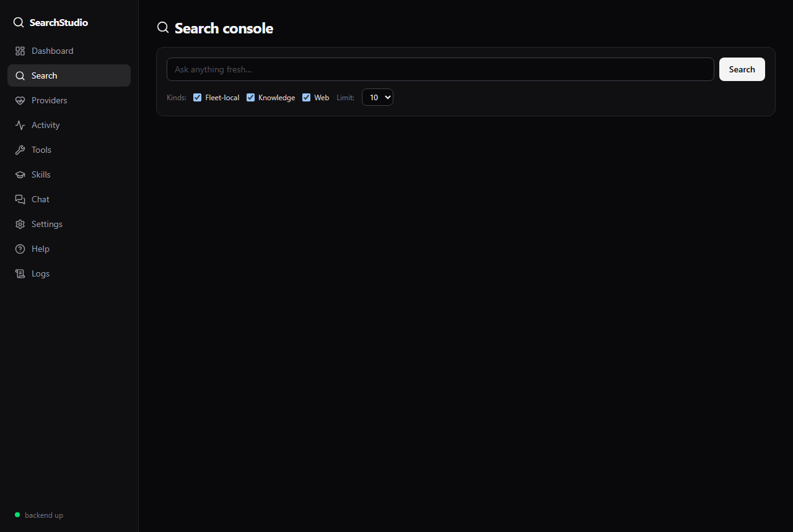
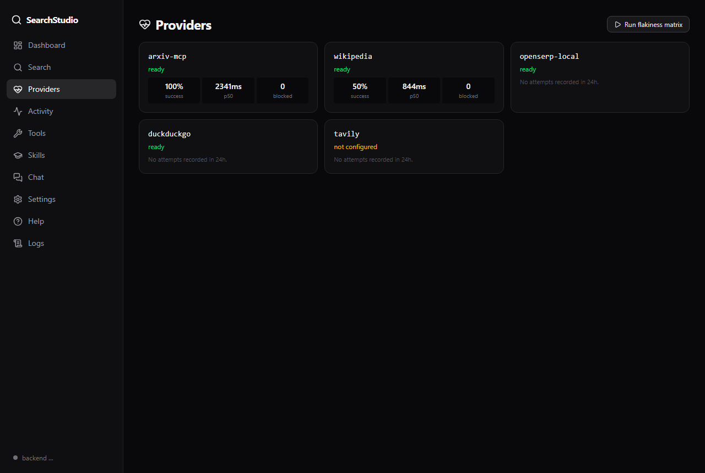

# SearchStudio

**Super search is all you need.** One query fans out in parallel across web search (OpenSERP, DuckDuckGo, Tavily), curated knowledge (Wikipedia, TVTropes, PubMed…), and your own fleet (arXiv depot, memory RAG) — then merges, dedupes, and shows receipts for which pipes answered and which blocked.

[]()
[]()
[](LICENSE)

## Preview

| Search console | Provider health |
|---|---|
|  |  |
| *One query, three provider kinds, receipts per pipe.* | *Success rate, latency, block rate — the arms race, quantified.* |

## What You Can Do

- Ask once, search everywhere — [web search](#serp), [Wikipedia](#wikipedia), your [arXiv depot](#arxiv-depot), your [memory vault](#memory-vault)
- See *receipts*: which [providers](#providers-and-targets) answered, which were blocked, how slow each was
- Keep working when pipes die — dead providers are skipped *and reported*, never silent zeros
- Run the flakiness matrix on demand — measure the iffiness instead of vibing it
- Feed aiwatcher breaking-news gaps and travel freshness checks (crossconnects)
- Chat with a search-expert skill, 4 personalities, local Ollama first

## How It Runs

Starlette backend + FastMCP over stdio (local) or HTTP (fleet consumers on `:11226`). SQLite health DB, no corpus, no index. Keyless providers work out of the box; [Tavily](#tavily)/[Exa](#exa)/[Brave](#brave) unlock when you add keys. Nothing phones home except the search providers you query.

## Providers and targets

Beginner-friendly guide to every name in this README. Experts: skip ahead.

### SERP

Search Engine Results Page — the generic term for "web search." Google, Bing, and DuckDuckGo are all SERP providers: you send words, they send ranked links. When we say "serp kind," we mean these whole-web engines as a group.

### OpenSERP

Free, open-source search software ([karust/openserp](https://github.com/karust/openserp)) that you run yourself in Docker. It queries six engines (Google, Bing, Yandex, Baidu, DuckDuckGo, Ecosia) and returns clean structured data — a free replacement for paid search APIs. Our default OpenSERP provider talks to your local copy; if Docker is down, it says so instead of silently returning nothing.

### DuckDuckGo

The privacy-focused search engine ([duckduckgo.com](https://duckduckgo.com)). We query its lightweight results page directly — no key, no account. Independent index and independent bot-luck from Google, which is exactly why it is in the fan-out: it answers when others block.

### Tavily

AI-native search API ([tavily.com](https://tavily.com)) built for LLM agents: ranked results plus page content, recency and news filters. Needs a free API key (1k calls/month, no card). Without a key it shows as "not configured" and everything else keeps working.

### Exa

Neural search API ([exa.ai](https://exa.ai)) that finds by meaning, not just keywords. Phase 2 provider — same interface, needs a key when it lands.

### Brave

Privacy search API ([brave.com/search/api](https://brave.com/search/api)) with clean grounding snippets. Phase 2 provider, keyed.

### Wikipedia

The free encyclopedia, queried through its official API (no key, generous limits). Best for entities, places, techniques, and history — intro extracts answer most questions in three sentences. A starting point for research, never the final citation.

### arXiv depot

Our sibling [arxiv-mcp](https://github.com/sandraschi/arxiv-mcp) indexes physics, CS, math, bio, and more preprints (arXiv plus bioRxiv, medRxiv, ChemRxiv, Research Square, SocArXiv, PsyArXiv). SearchStudio queries it as a fleet-local provider: your own papers, free, private, instant.

### Memory vault

Your personal knowledge base in [advanced-memory-mcp](https://github.com/sandraschi/advanced-memory-mcp) (memops): notes, inbox captures, distilled skills, searchable by meaning. Phase 3 crossconnect — today's searches become tomorrow's fleet-local answers.

## Quick Install

```bash
# Option A — drag & drop (Claude Desktop)
# Download searchstudio-{version}.mcpb from Releases, drop it on the Claude Desktop window
```

See [INSTALL.md](INSTALL.md) for all methods (mcpb, manual config, developer mode).

## Example Prompts

> Super-search the AMD–World Labs acquisition across web and news, newest first.

> Which providers are healthy right now, and who's been blocked today?

> Search my memory vault and Wikipedia for Hollabrunn local history.

## Fleet Crossconnects

| Companion | Direction | Purpose |
|---|---|---|
| [aiwatcher-mcp](https://github.com/sandraschi/aiwatcher-mcp) | aiwatcher → searchstudio | Breaking-news gap-filling (Phase 2) |
| [travelprep-mcp](https://github.com/sandraschi/travelprep-mcp) | travelprep → searchstudio | Freshness checks: advisories, prices (Phase 2 template) |
| [arxiv-mcp](https://github.com/sandraschi/arxiv-mcp) | searchstudio → arxiv-mcp | Fleet-local provider: preprint search |
| [tvtropes-mcp](https://github.com/sandraschi/tvtropes-mcp) | searchstudio → tvtropes-mcp | Trivia/content queries from their depot (Phase 2) |
| [advanced-memory-mcp](https://github.com/sandraschi/advanced-memory-mcp) | memops → searchstudio (optional) | Delegate `provider=auto` (Phase 3) |

Companions are optional and self-contained; nothing requires transitive installs.

## Documentation

| Doc | Contents |
|---|---|
| [Installation](INSTALL.md) | All install methods, prerequisites |
| [Onboarding](docs/ONBOARDING.md) | Provider keys (all optional), Docker for OpenSERP-local |
| [Product requirements](docs/PRD.md) | Vision, phases, success criteria |
| [Architecture](docs/ARCHITECTURE.md) | System design, data flow, ports |
| [Configuration](docs/CONFIGURATION.md) | Env vars, config options |
| [Tool Reference](docs/TOOLS.md) | All MCP operations |
| [Development](docs/DEVELOPMENT.md) | Contributing, local setup |
| [Troubleshooting](docs/TROUBLESHOOTING.md) | Common issues |

## Requirements

- Windows 10/11 (or any OS for stdio use), Python 3.11+ via `uv`
- Claude Desktop (or opencode / any MCP host)
- Docker *optional* — only for the OpenSERP-local provider; DDG + Wikipedia work without it
- No API keys required — Tavily/Exa/Brave keys unlock extra providers only

## License

MIT — see [LICENSE](LICENSE).
